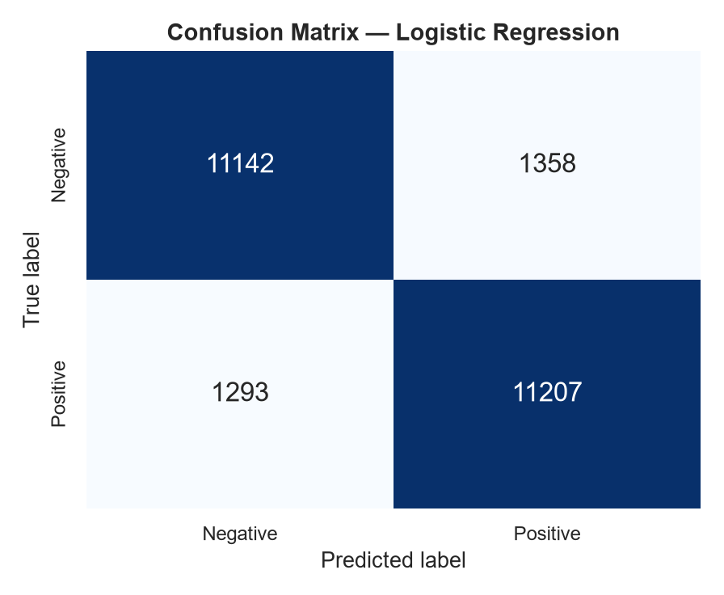
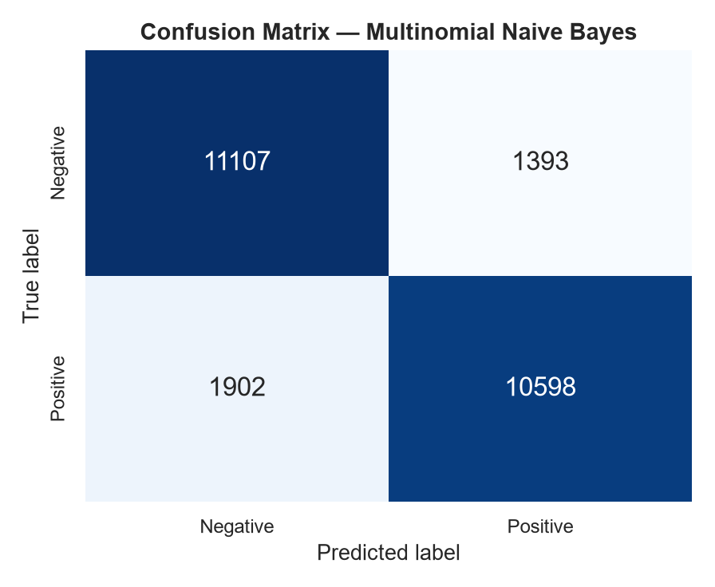

# Task 2 — Movie / Product Review Sentiment Classifier

An end-to-end **NLP text classification pipeline** that classifies customer
review sentiments as **positive** or **negative**, built with Python,
scikit-learn and NLTK.

---

## 1. Objective & Scope

Build and evaluate an NLP text classification pipeline to classify customer
review sentiments as positive or negative, and demonstrate real-time inference
on arbitrary user-supplied review text.

## 2. Dataset

**IMDB Movie Reviews** — the official corpus from *Maas et al. (2011), "Learning
Word Vectors for Sentiment Analysis"*, obtained from the
[`stanfordnlp/imdb`](https://huggingface.co/datasets/stanfordnlp/imdb) mirror
(the original `ai.stanford.edu` host was unreachable from this environment).

| Split | Reviews | Negative | Positive |
|---|---:|---:|---:|
| Train | 25,000 | 12,500 | 12,500 |
| Test (held out) | 25,000 | 12,500 | 12,500 |

The corpus ships with an **official disjoint train/test split**, which is kept
intact throughout the project.

## 3. Pipeline Architecture

```
raw review text
   │
   ▼
┌──────────────────────────────────────────────┐
│ TextPreprocessor (custom sklearn transformer)│
│  1. lowercasing                              │
│  2. HTML tag removal  (<br />, <b> …)        │
│  3. punctuation removal                      │
│  4. stop-word filtering (NLTK, 156 words)    │
│     • negations preserved (not/no/never/…)   │
└──────────────────────────────────────────────┘
   │  list of cleaned strings
   ▼
┌──────────────────────────────────────────────┐
│ TfidfVectorizer                              │
│  max_features = 50,000                       │
│  ngram_range  = (1, 2)   ← unigrams+bigrams │
│  min_df       = 2,  sublinear_tf = True      │
└──────────────────────────────────────────────┘
   │  sparse TF-IDF matrix
   ▼
┌──────────────────────────────────────────────┐
│ Classifier  (Logistic Regression | Multinomial NB) │
└──────────────────────────────────────────────┘
   │
   ▼
   positive / negative  (+ probability)
```

All four stages are chained in a single scikit-learn `Pipeline`, which is the
mechanism that makes leakage-free evaluation possible — see §6.

## 4. Project Structure

```
Task 2/
├── data/
│   └── imdb_parquet/               # downloaded IMDB train/test parquet
├── models/                         # saved artifacts (joblib)
│   ├── best_pipeline.joblib        # preprocess + TF-IDF + best classifier
│   ├── text_preprocessor.joblib
│   ├── tfidf_vectorizer.joblib
│   ├── logistic_regression_model.joblib
│   ├── multinomial_naive_bayes_model.joblib
│   └── metadata.json               # selected model + final metrics
├── outputs/
│   ├── metrics.csv                 # accuracy / precision / recall / F1
│   ├── classification_report_*.txt
│   └── confusion_matrix_*.png      # Seaborn heatmaps
├── src/
│   ├── dataset.py                  # download + load the corpus
│   ├── preprocess.py               # TextPreprocessor transformer
│   ├── train.py                    # training, comparison, evaluation
│   └── predict.py                  # interactive prediction CLI
├── requirements.txt
└── README.md
```

## 5. Setup & Usage

```bash
pip install -r requirements.txt

# 1. Train both models, evaluate on the held-out test split, save artifacts
python src/train.py

# 2. Interactive prediction (type reviews at the prompt, 'q' to quit)
python src/predict.py

# One-shot prediction
python src/predict.py --text "An absolute masterpiece, I loved every minute!"

# Built-in sample prediction log
python src/predict.py --demo

# Fast smoke test on a small subset
python src/train.py --quick 1000
```

## 6. Evaluation Protocol (no data leakage)

1. The **official test split is never used for fitting or model selection**.
2. A **validation set (10% of the training split, stratified, `random_state=42`)** is
   carved out of the training data only and used to compare the two algorithms.
3. `TF-IDF` IDF weights and vocabulary are learned **inside `Pipeline.fit()` on
   the training fold only** — the vectorizer is never exposed to test text.
4. After selection, each model is **refit on the full training split** and scored
   **exactly once** on the held-out test split.

## 7. Results

### 7.1 Model comparison — held-out test set (25,000 reviews)

| Model | Accuracy | Precision (macro) | Recall (macro) | F1-Score (macro) |
|---|---:|---:|---:|---:|
| **Logistic Regression** ✅ | **0.8940** | **0.8940** | **0.8940** | **0.8940** |
| Multinomial Naive Bayes | 0.8682 | 0.8688 | 0.8682 | 0.8681 |

*Validation split (10% of train, used for selection):* Logistic Regression
F1 = 0.8880 · Multinomial Naive Bayes F1 = 0.8760 → **Logistic Regression selected**.

### 7.2 Per-class metrics — Logistic Regression (selected model)

| Class | Precision | Recall | F1-Score | Support |
|---|---:|---:|---:|---:|
| negative | 0.8960 | 0.8914 | 0.8937 | 12,500 |
| positive | 0.8919 | 0.8966 | 0.8942 | 12,500 |
| **macro avg** | **0.8940** | **0.8940** | **0.8940** | 25,000 |
| weighted avg | 0.8940 | 0.8940 | 0.8940 | 25,000 |

> **Balanced precision/recall:** the gap between classes is ≤ 0.5 percentage
> points (recall 89.14% vs 89.66%; precision 89.60% vs 89.19%) — the model is
> not biased toward either sentiment.

### 7.3 Confusion matrices

| Logistic Regression | Multinomial Naive Bayes |
|---|---|
|  |  |

Full reports: `outputs/classification_report_logistic_regression.txt`,
`outputs/classification_report_multinomial_naive_bayes.txt`,
`outputs/metrics.csv`.


## 8. Interactive Prediction

Run `python src/predict.py` for a live prompt, or `--text "..."` / `--demo`.
Output from `python src/predict.py --demo` (Logistic Regression pipeline):

```
Sample prediction log
------------------------------------------------------------------------------
  > An absolute masterpiece. The acting was superb and the story kept me hooked till the end!
  Sentiment : POSITIVE  (confidence 89.2%)
  P(negative) = 10.8%   P(positive) = 89.2%
------------------------------------------------------------------------------
  > Terrible waste of two hours. Boring plot, wooden acting and the dialogue was cringe.
  Sentiment : NEGATIVE  (confidence 98.8%)
  P(negative) = 98.8%   P(positive) = 1.2%
------------------------------------------------------------------------------
  > It was okay, nothing special. Some good scenes but overall pretty average.
  Sentiment : NEGATIVE  (confidence 71.5%)
  P(negative) = 71.5%   P(positive) = 28.5%
------------------------------------------------------------------------------
  > I loved every minute of it - funny, smart and beautifully shot. Highly recommend!
  Sentiment : POSITIVE  (confidence 96.9%)
  P(negative) = 3.1%   P(positive) = 96.9%
------------------------------------------------------------------------------
  > Not what I expected at all. The product broke after a single week of use. Very disappointed.
  Sentiment : NEGATIVE  (confidence 67.4%)
  P(negative) = 67.4%   P(positive) = 32.6%
------------------------------------------------------------------------------
  > Great value for money, works exactly as described and arrived a day early.
  Sentiment : POSITIVE  (confidence 77.5%)
  P(negative) = 22.5%   P(positive) = 77.5%
------------------------------------------------------------------------------
```

One-shot mode with custom user input:

```
$ python src/predict.py --text "Don't waste your money, this product broke after two days of use."
  Sentiment : NEGATIVE  (confidence 93.0%)
  P(negative) = 93.0%   P(positive) = 7.0%
```

Programmatic use:

```python
from predict import predict_sentiment
predict_sentiment("Best purchase I've made all year")
# {'label': 'positive', 'confidence': 0.88..., 'probabilities': {...}}
```

> Note: the "okay / nothing special" case is the expected borderline behaviour
> — genuinely neutral reviews sit near the decision boundary and are reported
> with correspondingly lower confidence (71.5%).


## 9. Acceptance Criteria

| Criterion | Status |
|---|---|
| Balanced precision and recall on a held-out test dataset | ✅ see §7 |
| Evaluation strictly on test data, no preprocessing leakage | ✅ see §6 |
| Interactive test function demonstrates real-time inference | ✅ see §8 |
| Preprocessing: lowercase, punctuation removal, stop-word filter, TF-IDF | ✅ see §3 |
| Model comparison (Logistic Regression vs Multinomial Naive Bayes) | ✅ see §7 |
| Metrics: Accuracy, Precision, Recall, F1, Confusion Matrix | ✅ `outputs/` |
| Saved vectorizer + model pipeline (joblib) | ✅ `models/` |
| README with metrics table and sample prediction logs | ✅ this file |

## 10. References

- Maas, A. L., Daly, R. E., Pham, P. T., Huang, D., Ng, A. Y., & Potts, C. (2011).
  *Learning Word Vectors for Sentiment Analysis.* ACL.
- NLTK stopwords: https://www.nltk.org/
- scikit-learn: `TfidfVectorizer`, `LogisticRegression`, `MultinomialNB`
